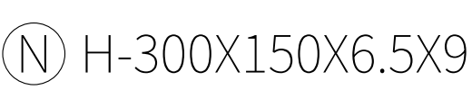
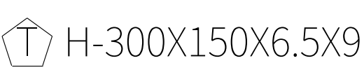
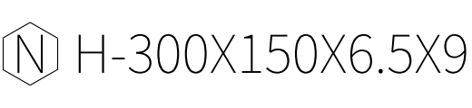

# 自绘材质符号：可编辑 CAD 参考

三个源文件各只包含一个符号和一个普通单行 TEXT：

| 参考 | DWG | DXF |
| --- | --- | --- |
| 圆框 N | [打开](circle_N.dwg) | [打开](circle_N.dxf) |
| 五角框 T | [打开](pentagon_T.dwg) | [打开](pentagon_T.dxf) |
| 六角框 N | [打开](hexagon_N.dwg) | [打开](hexagon_N.dxf) |

这些只是绘制和导入参考，不对应工程材质牌号，不会自动写入自定义材质库。请自行填写真实材质名称和别名。

1. 只保留准备导入的符号，删除旁注、尺寸、辅助轴线和其他符号。使用 XY 平面直线、圆、圆弧或零宽度二维多段线。
2. 字母保留为水平、左对齐的普通单行 TEXT，宽度因子 1，不倾斜、不反向、不转轮廓。示例使用当前程序的 NotoSansSC-VF.ttf；字体不兼容时软件会拒绝，不自动替换。只有块引用的文件应先展开为普通图元，并保留文字。
3. 先在 CAD 中把字放在外框合适的位置。示例字高 100、外框高 165，可导入后按默认行高排布；这只是比例参考，字高不必是 100。
4. 整个符号可等比例画大或画小。导入选“按文字字号匹配断面”，程序按所选 TEXT 的 CAD 字高统一缩放，以其基线对齐断面，不按圆径或 N/T 的轮廓宽度猜大小。
5. 存在不同字高的多条文字时，明确选择基准字。其余内容保持相对大小和位置。没有普通 TEXT 的符号不能保证按字符字号匹配。
6. 在“材质符号库 → 追加自定义材质符号”填写材质名、导入 DWG/DXF、检查“符号＋断面”预览，再确认保存。未知牌号不会被猜测成示例里的 N 或 T。

外框相对文字过大时，应在原 CAD 中调整这个比例，或明确调整整表行高；超出容量会提示。程序保留原图内部相对布局，不独立压扁外框，因此将字放到图形正中间这一步由绘制者完成。

以下为导入后的对照图，后面的断面文字不在源 CAD 中：

复现工具：`tools/generate_material_symbol_sources.py`。实际 DWG 回读、DWG/DXF 双格式导入、文字单位化和默认行高检查结果见 `validation.json`。仍需在 AutoCAD LT 2024 打开确认字体和显示。
